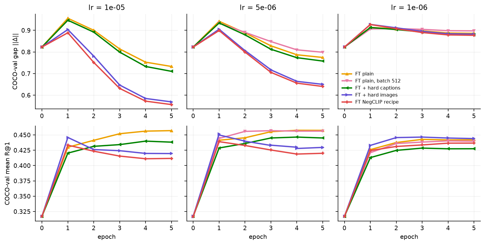
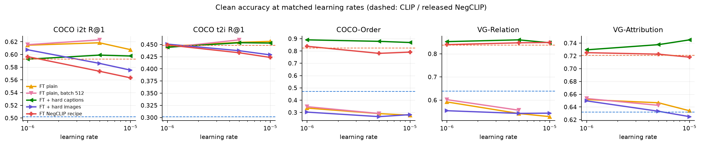
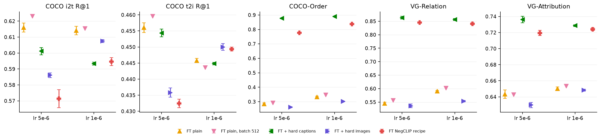
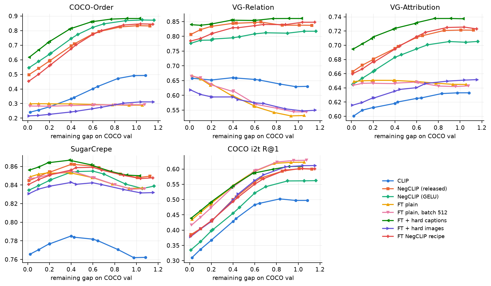
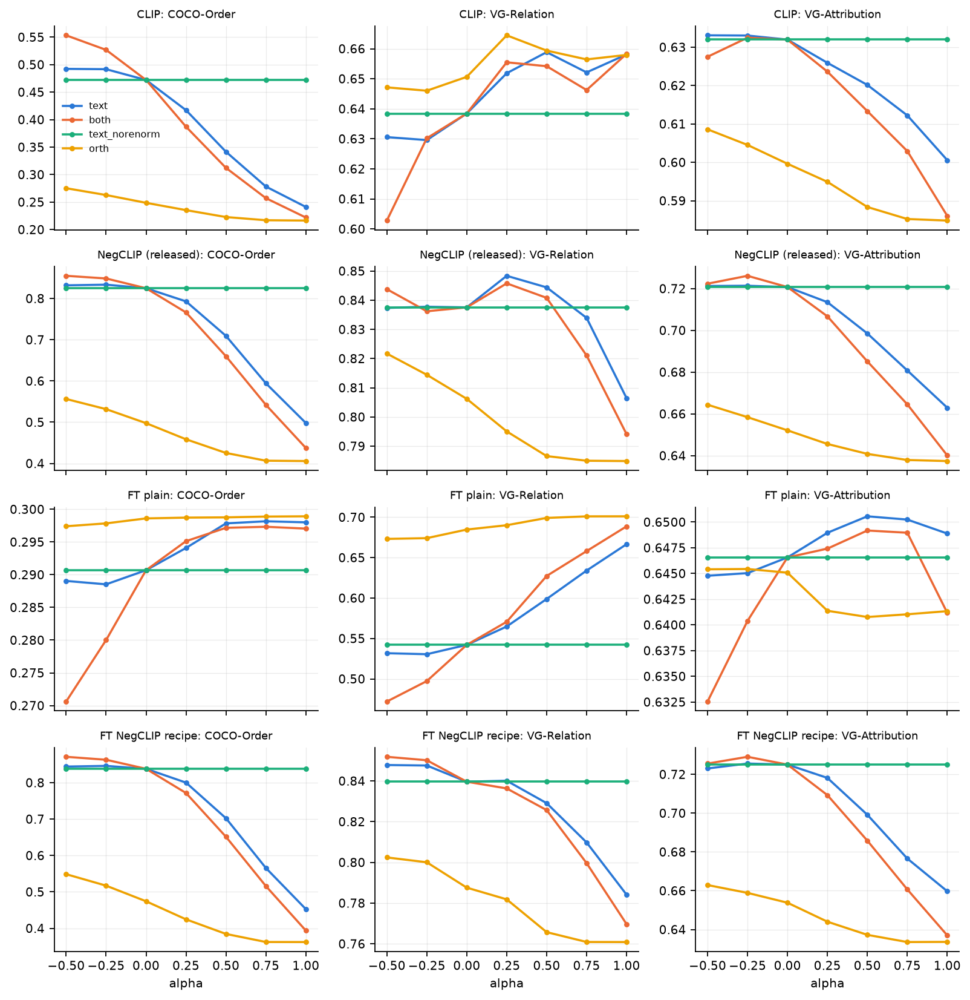
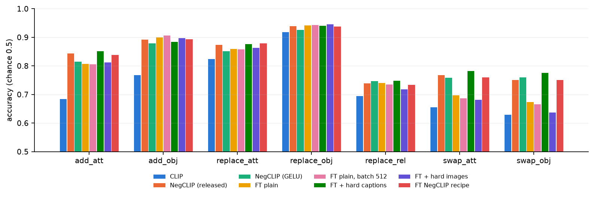
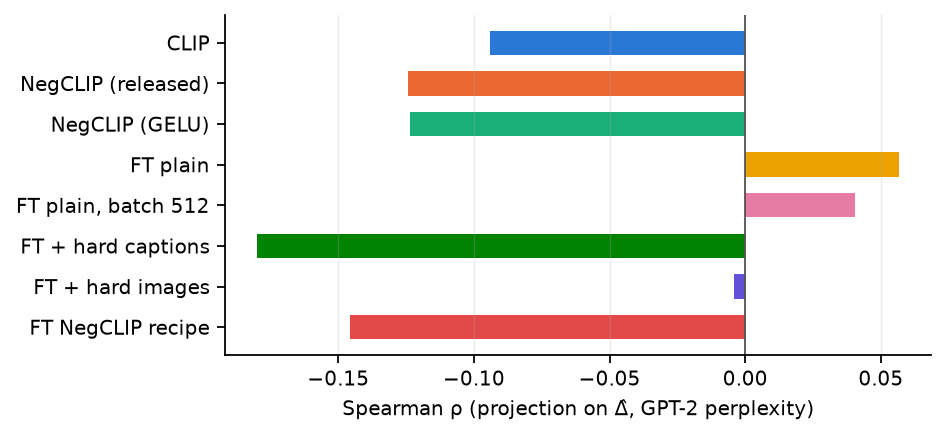

# Final GPU run: results summary

## Fine-tuning runs: validation gap and R@1 over training (seed 0)

| config      |   ('val_gap_norm', 1e-06) |   ('val_gap_norm', 5e-06) |   ('val_gap_norm', 1e-05) |   ('val_mean_R@1', 1e-06) |   ('val_mean_R@1', 5e-06) |   ('val_mean_R@1', 1e-05) |
|:------------|--------------------------:|--------------------------:|--------------------------:|--------------------------:|--------------------------:|--------------------------:|
| ft_plain    |                     0.886 |                     0.775 |                     0.733 |                     0.442 |                     0.457 |                     0.457 |
| ft_plain512 |                     0.897 |                     0.799 |                   nan     |                     0.440 |                     0.456 |                   nan     |
| ft_hardcap  |                     0.880 |                     0.758 |                     0.710 |                     0.427 |                     0.445 |                     0.438 |
| ft_hardimg  |                     0.883 |                     0.650 |                     0.569 |                     0.444 |                     0.430 |                     0.420 |
| ft_negclip  |                     0.877 |                     0.640 |                     0.557 |                     0.437 |                     0.420 |                     0.412 |

## Matched-LR comparison (seed 0, clean accuracy, alpha = 0)

|                        |   COCO i2t R@1 |   COCO t2i R@1 |   COCO-Order |   VG-Relation |   VG-Attribution |
|:-----------------------|---------------:|---------------:|-------------:|--------------:|-----------------:|
| ('ft_hardcap', 1e-06)  |          0.593 |          0.444 |        0.890 |         0.852 |            0.729 |
| ('ft_hardcap', 5e-06)  |          0.599 |          0.454 |        0.878 |         0.860 |            0.738 |
| ('ft_hardcap', 1e-05)  |          0.598 |          0.453 |        0.869 |         0.848 |            0.745 |
| ('ft_hardimg', 1e-06)  |          0.607 |          0.451 |        0.303 |         0.554 |            0.650 |
| ('ft_hardimg', 5e-06)  |          0.586 |          0.437 |        0.266 |         0.543 |            0.633 |
| ('ft_hardimg', 1e-05)  |          0.575 |          0.429 |        0.282 |         0.544 |            0.625 |
| ('ft_negclip', 1e-06)  |          0.597 |          0.449 |        0.838 |         0.840 |            0.725 |
| ('ft_negclip', 5e-06)  |          0.574 |          0.433 |        0.781 |         0.847 |            0.723 |
| ('ft_negclip', 1e-05)  |          0.563 |          0.423 |        0.791 |         0.849 |            0.718 |
| ('ft_plain', 1e-06)    |          0.615 |          0.446 |        0.336 |         0.592 |            0.652 |
| ('ft_plain', 5e-06)    |          0.618 |          0.454 |        0.291 |         0.542 |            0.647 |
| ('ft_plain', 1e-05)    |          0.608 |          0.456 |        0.278 |         0.529 |            0.634 |
| ('ft_plain512', 1e-06) |          0.615 |          0.444 |        0.347 |         0.602 |            0.653 |
| ('ft_plain512', 5e-06) |          0.623 |          0.460 |        0.292 |         0.556 |            0.643 |

Reference (no fine-tuning / released NegCLIP):

|         |   COCO i2t R@1 |   COCO t2i R@1 |   COCO-Order |   VG-Relation |   VG-Attribution |
|:--------|---------------:|---------------:|-------------:|--------------:|-----------------:|
| clip    |          0.502 |          0.302 |        0.472 |         0.638 |            0.632 |
| negclip |          0.593 |          0.448 |        0.825 |         0.838 |            0.721 |

## Seed variance (seeds 0, 1, 2; mean ± std)

|                        | COCO i2t R@1   | COCO t2i R@1   | COCO-Order    | VG-Relation   | VG-Attribution   |   n seeds |
|:-----------------------|:---------------|:---------------|:--------------|:--------------|:-----------------|----------:|
| ('ft_hardcap', 1e-06)  | 0.593 ± 0.001  | 0.445 ± 0.000  | 0.890 ± 0.001 | 0.856 ± 0.004 | 0.729 ± 0.001    |         3 |
| ('ft_hardcap', 5e-06)  | 0.601 ± 0.002  | 0.454 ± 0.001  | 0.877 ± 0.002 | 0.863 ± 0.005 | 0.736 ± 0.004    |         3 |
| ('ft_hardimg', 1e-06)  | 0.607 ± 0.001  | 0.450 ± 0.001  | 0.301 ± 0.001 | 0.553 ± 0.003 | 0.648 ± 0.001    |         3 |
| ('ft_hardimg', 5e-06)  | 0.586 ± 0.002  | 0.436 ± 0.001  | 0.262 ± 0.003 | 0.536 ± 0.007 | 0.630 ± 0.003    |         3 |
| ('ft_negclip', 1e-06)  | 0.595 ± 0.003  | 0.449 ± 0.001  | 0.838 ± 0.001 | 0.841 ± 0.004 | 0.724 ± 0.002    |         3 |
| ('ft_negclip', 5e-06)  | 0.571 ± 0.006  | 0.432 ± 0.001  | 0.777 ± 0.003 | 0.845 ± 0.002 | 0.719 ± 0.003    |         3 |
| ('ft_plain', 1e-06)    | 0.614 ± 0.003  | 0.446 ± 0.001  | 0.333 ± 0.005 | 0.591 ± 0.002 | 0.650 ± 0.002    |         3 |
| ('ft_plain', 5e-06)    | 0.616 ± 0.003  | 0.456 ± 0.002  | 0.284 ± 0.007 | 0.545 ± 0.005 | 0.643 ± 0.005    |         3 |
| ('ft_plain512', 1e-06) | 0.615 ± 0.000  | 0.444 ± 0.000  | 0.347 ± 0.000 | 0.602 ± 0.000 | 0.653 ± 0.000    |         1 |
| ('ft_plain512', 5e-06) | 0.623 ± 0.000  | 0.460 ± 0.000  | 0.292 ± 0.000 | 0.556 ± 0.000 | 0.643 ± 0.000    |         1 |

## Batch-size control: is the hard-image effect just a bigger batch?

|                        |   val_gap |   COCO i2t R@1 |   COCO t2i R@1 |   COCO-Order |   VG-Relation |   VG-Attribution |
|:-----------------------|----------:|---------------:|---------------:|-------------:|--------------:|-----------------:|
| ('ft_plain', 5e-06)    |     0.775 |          0.618 |          0.454 |        0.291 |         0.542 |            0.647 |
| ('ft_plain', 1e-06)    |     0.886 |          0.615 |          0.446 |        0.336 |         0.592 |            0.652 |
| ('ft_plain512', 5e-06) |     0.799 |          0.623 |          0.460 |        0.292 |         0.556 |            0.643 |
| ('ft_plain512', 1e-06) |     0.897 |          0.615 |          0.444 |        0.347 |         0.602 |            0.653 |
| ('ft_hardimg', 5e-06)  |     0.650 |          0.586 |          0.437 |        0.266 |         0.543 |            0.633 |
| ('ft_hardimg', 1e-06)  |     0.883 |          0.607 |          0.451 |        0.303 |         0.554 |            0.650 |

## Gap geometry of the core models (Approach 01)

| model        | split     |   gap_norm |   centroid_cos |   matched_cos |   var_frac_img |   var_frac_txt |   linear_sep_acc |
|:-------------|:----------|-----------:|---------------:|--------------:|---------------:|---------------:|-----------------:|
| clip         | coco_test |      0.832 |          0.304 |         0.303 |          0.004 |          0.007 |            1.000 |
| negclip      | coco_test |      0.855 |          0.184 |         0.292 |          0.003 |          0.007 |            1.000 |
| negclip_gelu | coco_test |      0.903 |          0.208 |         0.286 |          0.002 |          0.006 |            1.000 |
| ft_plain     | coco_test |      0.780 |          0.127 |         0.297 |          0.003 |          0.008 |            1.000 |
| ft_plain512  | coco_test |      0.805 |          0.148 |         0.297 |          0.003 |          0.008 |            1.000 |
| ft_hardcap   | coco_test |      0.765 |          0.096 |         0.292 |          0.003 |          0.008 |            1.000 |
| ft_hardimg   | coco_test |      0.888 |          0.204 |         0.297 |          0.002 |          0.007 |            1.000 |
| ft_negclip   | coco_test |      0.883 |          0.192 |         0.293 |          0.002 |          0.007 |            1.000 |

## Closing the gap post hoc (mode text, mean Δ, no noise): accuracy vs remaining gap

| model        |   gap_before |   gap_after |   Δ COCO-Order |   Δ VG-Relation |   Δ VG-Attribution |   Δ SugarCrepe |   Δ COCO i2t R@1 |
|:-------------|-------------:|------------:|---------------:|----------------:|-------------------:|---------------:|-----------------:|
| clip         |       +0.831 |      +0.100 |         -0.216 |          +0.017 |             -0.023 |         -0.000 |           -0.165 |
| negclip      |       +0.853 |      +0.100 |         -0.284 |          -0.015 |             -0.049 |         -0.003 |           -0.188 |
| negclip_gelu |       +0.902 |      +0.100 |         -0.279 |          -0.024 |             -0.052 |         -0.002 |           -0.199 |
| ft_plain     |       +0.779 |      +0.100 |         +0.008 |          +0.114 |             +0.004 |         +0.011 |           -0.161 |
| ft_plain512  |       +0.803 |      +0.100 |         -0.009 |          +0.103 |             +0.004 |         +0.008 |           -0.181 |
| ft_hardcap   |       +0.763 |      +0.100 |         -0.211 |          -0.023 |             -0.036 |         +0.005 |           -0.135 |
| ft_hardimg   |       +0.886 |      +0.100 |         -0.084 |          +0.049 |             -0.030 |         +0.001 |           -0.204 |
| ft_negclip   |       +0.881 |      +0.100 |         -0.338 |          -0.047 |             -0.058 |         -0.005 |           -0.192 |

## H3 controls: shift without re-normalisation, and orthogonalised shift

Accuracy change at alpha = 1 vs alpha = 0 (text_norenorm must be ~0 by construction):

|                                   |   COCO-Order |   SugarCrepe |   VG-Attribution |   VG-Relation |
|:----------------------------------|-------------:|-------------:|-----------------:|--------------:|
| ('clip', 'both')                  |      -0.2501 |      -0.0130 |          -0.0459 |       +0.0199 |
| ('clip', 'orth')                  |      -0.0323 |      -0.0100 |          -0.0148 |       +0.0073 |
| ('clip', 'text')                  |      -0.2309 |      -0.0049 |          -0.0314 |       +0.0197 |
| ('clip', 'text_norenorm')         |      +0.0000 |      +0.0000 |          +0.0000 |       +0.0000 |
| ('ft_hardcap', 'both')            |      -0.3645 |      -0.0068 |          -0.0702 |       -0.0350 |
| ('ft_hardcap', 'orth')            |      -0.0946 |      -0.0077 |          -0.0130 |       -0.0173 |
| ('ft_hardcap', 'text')            |      -0.2613 |      +0.0015 |          -0.0432 |       -0.0207 |
| ('ft_hardcap', 'text_norenorm')   |      +0.0000 |      +0.0000 |          +0.0000 |       +0.0000 |
| ('ft_hardimg', 'both')            |      -0.0938 |      -0.0091 |          -0.0437 |       +0.0736 |
| ('ft_hardimg', 'orth')            |      -0.0087 |      -0.0057 |          -0.0093 |       +0.0211 |
| ('ft_hardimg', 'text')            |      -0.0872 |      -0.0044 |          -0.0339 |       +0.0641 |
| ('ft_hardimg', 'text_norenorm')   |      +0.0000 |      +0.0000 |          +0.0000 |       +0.0000 |
| ('ft_negclip', 'both')            |      -0.4444 |      -0.0210 |          -0.0880 |       -0.0699 |
| ('ft_negclip', 'orth')            |      -0.1120 |      -0.0146 |          -0.0202 |       -0.0267 |
| ('ft_negclip', 'text')            |      -0.3854 |      -0.0097 |          -0.0653 |       -0.0555 |
| ('ft_negclip', 'text_norenorm')   |      +0.0000 |      +0.0000 |          +0.0000 |       +0.0000 |
| ('ft_plain', 'both')              |      +0.0064 |      +0.0049 |          -0.0054 |       +0.1466 |
| ('ft_plain', 'orth')              |      +0.0003 |      -0.0028 |          -0.0037 |       +0.0164 |
| ('ft_plain', 'text')              |      +0.0073 |      +0.0079 |          +0.0023 |       +0.1245 |
| ('ft_plain', 'text_norenorm')     |      +0.0000 |      +0.0000 |          +0.0000 |       +0.0000 |
| ('ft_plain512', 'both')           |      -0.0124 |      +0.0043 |          -0.0101 |       +0.1243 |
| ('ft_plain512', 'orth')           |      -0.0002 |      -0.0019 |          -0.0032 |       +0.0183 |
| ('ft_plain512', 'text')           |      -0.0086 |      +0.0067 |          +0.0012 |       +0.1087 |
| ('ft_plain512', 'text_norenorm')  |      +0.0000 |      +0.0000 |          +0.0000 |       +0.0000 |
| ('negclip', 'both')               |      -0.3874 |      -0.0132 |          -0.0807 |       -0.0434 |
| ('negclip', 'orth')               |      -0.0919 |      -0.0075 |          -0.0147 |       -0.0213 |
| ('negclip', 'text')               |      -0.3268 |      -0.0072 |          -0.0578 |       -0.0311 |
| ('negclip', 'text_norenorm')      |      +0.0000 |      +0.0000 |          +0.0000 |       +0.0000 |
| ('negclip_gelu', 'both')          |      -0.3783 |      -0.0150 |          -0.0757 |       -0.0425 |
| ('negclip_gelu', 'orth')          |      -0.1198 |      -0.0130 |          -0.0178 |       -0.0166 |
| ('negclip_gelu', 'text')          |      -0.3225 |      -0.0064 |          -0.0605 |       -0.0344 |
| ('negclip_gelu', 'text_norenorm') |      +0.0000 |      +0.0000 |          +0.0000 |       +0.0000 |

Accuracy change from only removing each caption's deviation along the gap direction (orth at alpha = 0 vs the unshifted model):

| model        |   COCO-Order |   SugarCrepe |   VG-Attribution |   VG-Relation |
|:-------------|-------------:|-------------:|-----------------:|--------------:|
| clip         |       -0.223 |       -0.004 |           -0.032 |        +0.012 |
| negclip      |       -0.327 |       -0.009 |           -0.069 |        -0.031 |
| negclip_gelu |       -0.281 |       -0.003 |           -0.060 |        -0.032 |
| ft_plain     |       +0.008 |       +0.006 |           -0.001 |        +0.143 |
| ft_plain512  |       -0.010 |       +0.005 |           -0.007 |        +0.121 |
| ft_hardcap   |       -0.316 |       -0.003 |           -0.061 |        -0.025 |
| ft_hardimg   |       -0.086 |       -0.005 |           -0.036 |        +0.061 |
| ft_negclip   |       -0.364 |       -0.010 |           -0.071 |        -0.052 |

## Robustness to embedding noise: does a closed gap help under noise?

Accuracy change from closing the gap (smallest target) at each noise level σ:

|                                 |    0.0 |   0.25 |    0.5 |    1.0 |
|:--------------------------------|-------:|-------:|-------:|-------:|
| ('COCO-Order', 'clip')          | -0.216 | -0.143 | -0.085 | -0.034 |
| ('COCO-Order', 'ft_hardcap')    | -0.211 | -0.177 | -0.136 | -0.071 |
| ('COCO-Order', 'ft_hardimg')    | -0.084 | -0.052 | -0.030 | -0.012 |
| ('COCO-Order', 'ft_negclip')    | -0.338 | -0.236 | -0.142 | -0.060 |
| ('COCO-Order', 'ft_plain')      | +0.008 | +0.010 | +0.008 | +0.002 |
| ('COCO-Order', 'ft_plain512')   | -0.009 | -0.006 | -0.003 | -0.003 |
| ('COCO-Order', 'negclip')       | -0.284 | -0.203 | -0.124 | -0.054 |
| ('COCO-Order', 'negclip_gelu')  | -0.279 | -0.182 | -0.103 | -0.043 |
| ('SugarCrepe', 'clip')          | -0.000 | +0.033 | +0.040 | +0.021 |
| ('SugarCrepe', 'ft_hardcap')    | +0.005 | +0.020 | +0.032 | +0.021 |
| ('SugarCrepe', 'ft_hardimg')    | +0.001 | +0.039 | +0.053 | +0.027 |
| ('SugarCrepe', 'ft_negclip')    | -0.005 | +0.029 | +0.045 | +0.023 |
| ('SugarCrepe', 'ft_plain')      | +0.011 | +0.031 | +0.041 | +0.025 |
| ('SugarCrepe', 'ft_plain512')   | +0.008 | +0.036 | +0.048 | +0.030 |
| ('SugarCrepe', 'negclip')       | -0.003 | +0.028 | +0.043 | +0.022 |
| ('SugarCrepe', 'negclip_gelu')  | -0.002 | +0.035 | +0.053 | +0.030 |
| ('VG-Relation', 'clip')         | +0.017 | +0.039 | +0.015 | +0.018 |
| ('VG-Relation', 'ft_hardcap')   | -0.023 | -0.016 | -0.012 | -0.003 |
| ('VG-Relation', 'ft_hardimg')   | +0.049 | +0.085 | +0.058 | +0.026 |
| ('VG-Relation', 'ft_negclip')   | -0.047 | -0.026 | -0.014 | -0.007 |
| ('VG-Relation', 'ft_plain')     | +0.114 | +0.105 | +0.067 | +0.042 |
| ('VG-Relation', 'ft_plain512')  | +0.103 | +0.118 | +0.076 | +0.032 |
| ('VG-Relation', 'negclip')      | -0.015 | -0.019 | -0.010 | -0.002 |
| ('VG-Relation', 'negclip_gelu') | -0.024 | -0.002 | +0.008 | +0.006 |

## SugarCrepe by subset (clean, and after closing the gap with alpha = 1, mode text)

| model        |   add_att |   add_obj |   replace_att |   replace_obj |   replace_rel |   swap_att |   swap_obj |   mean |
|:-------------|----------:|----------:|--------------:|--------------:|--------------:|-----------:|-----------:|-------:|
| clip         |     0.684 |     0.767 |         0.824 |         0.918 |         0.695 |      0.655 |      0.629 |  0.739 |
| negclip      |     0.844 |     0.892 |         0.873 |         0.939 |         0.739 |      0.767 |      0.751 |  0.829 |
| negclip_gelu |     0.815 |     0.879 |         0.852 |         0.926 |         0.746 |      0.758 |      0.759 |  0.819 |
| ft_plain     |     0.806 |     0.900 |         0.859 |         0.942 |         0.740 |      0.697 |      0.673 |  0.803 |
| ft_plain512  |     0.805 |     0.906 |         0.858 |         0.942 |         0.735 |      0.686 |      0.665 |  0.800 |
| ft_hardcap   |     0.851 |     0.884 |         0.876 |         0.941 |         0.748 |      0.782 |      0.776 |  0.837 |
| ft_hardimg   |     0.812 |     0.897 |         0.863 |         0.946 |         0.718 |      0.682 |      0.637 |  0.793 |
| ft_negclip   |     0.838 |     0.894 |         0.879 |         0.938 |         0.733 |      0.760 |      0.751 |  0.828 |

Change after closing the gap (alpha = 1):

| model        |   add_att |   add_obj |   replace_att |   replace_obj |   replace_rel |   swap_att |   swap_obj |
|:-------------|----------:|----------:|--------------:|--------------:|--------------:|-----------:|-----------:|
| clip         |    +0.218 |    +0.059 |        -0.094 |        -0.004 |        -0.115 |     -0.081 |     -0.057 |
| negclip      |    +0.100 |    +0.045 |        -0.055 |        +0.002 |        -0.056 |     -0.110 |     -0.094 |
| negclip_gelu |    +0.107 |    +0.060 |        -0.065 |        +0.006 |        -0.075 |     -0.113 |     -0.094 |
| ft_plain     |    +0.150 |    +0.043 |        -0.039 |        +0.002 |        -0.048 |     -0.045 |     -0.029 |
| ft_plain512  |    +0.153 |    +0.048 |        -0.048 |        +0.003 |        -0.055 |     -0.056 |     -0.024 |
| ft_hardcap   |    +0.088 |    +0.054 |        -0.041 |        +0.007 |        -0.045 |     -0.084 |     -0.094 |
| ft_hardimg   |    +0.142 |    +0.040 |        -0.074 |        -0.001 |        -0.063 |     -0.087 |     -0.033 |
| ft_negclip   |    +0.105 |    +0.043 |        -0.077 |        +0.005 |        -0.063 |     -0.111 |     -0.078 |

## Caption naturalness: projection on the gap direction vs GPT-2 perplexity (COCO-Order)

| model        |   spearman_rho |   p_value |          n |
|:-------------|---------------:|----------:|-----------:|
| clip         |         -0.094 |     0.000 | 119724.000 |
| negclip      |         -0.124 |     0.000 | 119724.000 |
| negclip_gelu |         -0.124 |     0.000 | 119724.000 |
| ft_plain     |          0.057 |     0.000 | 119724.000 |
| ft_plain512  |          0.041 |     0.000 | 119724.000 |
| ft_hardcap   |         -0.180 |     0.000 | 119724.000 |
| ft_hardimg   |         -0.004 |     0.140 | 119724.000 |
| ft_negclip   |         -0.146 |     0.000 | 119724.000 |

